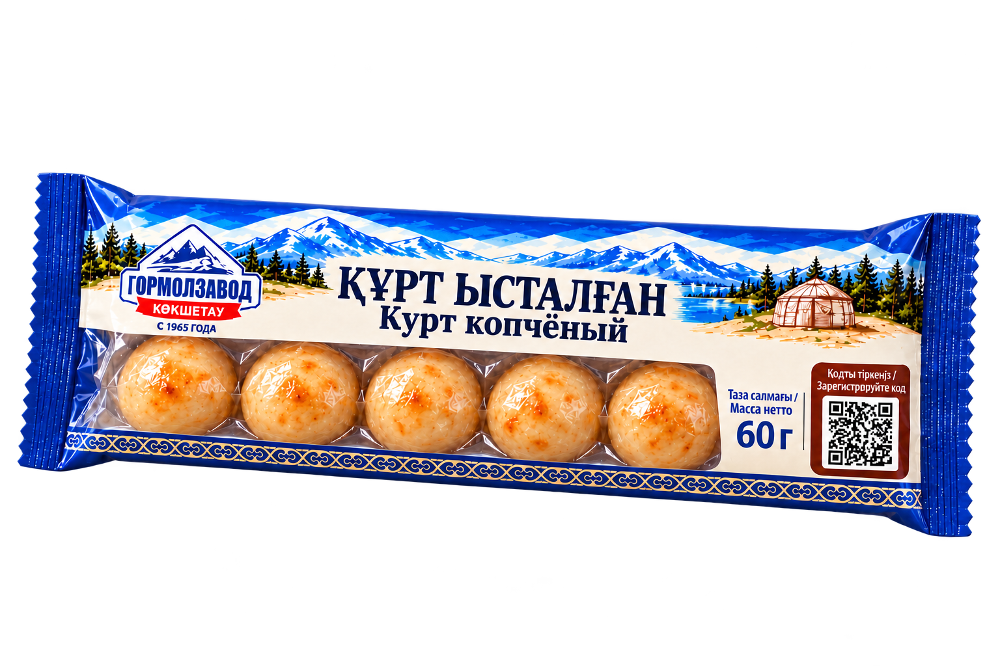

# ҚҰРТ · q.club — копчёный курт «Гормолзавод Көкшетау», который хочется взять снова

> **Знакомый вкус. Новый повод вернуться.**
> Команда **K-On!** · AI Design Hackathon 2.0 · 2026 · Партнёр: ТОО «Гормолзавод», Кокшетау (с 1965 года)

**Демо-сайт:** https://g1gantera.github.io/hackathon-gormolzavod-qurt/



---

## Идея в одном предложении (УТП)

**Копчёный курт «Гормолзавод» в лёгком пакете 60 г с окном: пять шариков видны сразу, а QR на лицевой стороне превращает каждую покупку в шаг к подаркам q.club.**

Мы не просто нарисовали упаковку. Мы сделали единое решение, как просит ТЗ: **упаковка = точка входа в базу клиентов Партнёра**. Промо-зона встроена в макет, а не наклеена сверху.

## Почему это выигрывает на полке

Мы сначала вышли в магазины (Small, Аида), сфотографировали полки и посчитали цены, а потом рисовали.

| Конкурент | Масса | Цена, ₸ | ₸ / 100 г |
|---|---|---|---|
| Золото Тюрков | 30 г | 415 | 1 383 |
| Золото Тюрков | 50 г | 710 | 1 420 |
| Золото Тюрков | 70 г | 765 | 1 093 |
| Ферма Орда | 80 г | 880 | 1 100 |

Что мы увидели и как это использовали:

1. **Полка тёмная.** Коричнево-золотые и красные пакеты сливаются в одну массу. Мы взяли светлый кремовый фон и яркий синий бренда: упаковку видно за 1–2 метра.
2. **Свободная ниша по массе.** У конкурентов 30–50 г и 70–80 г. Наши **60 г (5 шариков по 12 г)** встают ровно между ними. Ориентир розницы по полке около 660–850 ₸.
3. **Название читается.** У конкурента оно мелкое, золотом на тёмном. У нас **«ҚҰРТ ЫСТАЛҒАН / Курт копчёный»** крупно, казахский первым.
4. **Продукт виден.** Окно во всю длину показывает все пять шариков до покупки.

## Упаковка

- **Формат:** флоу-пак 60 г, прозрачное окно, 5 шариков по 12 г.
- **Лицевая сторона:** логотип «Гормолзавод Көкшетау · С 1965 года», крупное наименование, масса «Таза салмағы / Масса нетто 60 г», промо-зона с QR «Кодты тіркеңіз / Зарегистрируйте код».
- **Оборот:** состав, пищевая и энергетическая ценность (белки 60 г, углеводы 17 г, 200 ккал / 837 кДж), хранение до +15 °C и влажность до 75 %, срок 3 месяца, изготовитель и адрес, контакты, поля даты выработки и партии, место под EAN-13. Всё на казахском и русском, данные из ТЗ без изменений.
- **Фирменный стиль:** логотип по брендбуку, палитра бренда (синий, кремовый), казахский орнамент и пейзаж Көкшетау без перегруза.
- **Тара по ТЗ (п. 2.2):** пакет из комбинированного термосвариваемого материала. Производители для запроса КП: Bios Flexo (Алматы), Premiumpack (Алматинская обл.).

## Промо-механика q.club

Путь покупателя из 5 шагов:

1. **Покупка.** Покупатель видит промо-зону на упаковке.
2. **QR.** Сканирует код и попадает на лендинг, без установки приложения.
3. **Профиль и код.** Регистрация за минуту: имя, телефон, город, возрастная группа (4 поля, меньше 6 по ТЗ), согласие на обработку данных. Уникальный код с внутренней стороны упаковки.
4. **Награда.** Накопительные подарки q.club за 1, 3 и 5 кодов.
5. **Новый контакт и повторная покупка.** Сообщения на согласованные номера: «Первый код принят!», «До кружки осталось 2 кода», «Акция заканчивается через 3 дня».

**Метрики пилота на 30 дней (цели, а не прогноз):** 500 регистраций · 20 % участников с 2+ кодами · 150 активных за последние 7 дней.

### Как это работает в демо

- Двуязычный интерфейс **ҚАЗ / РУС**.
- Регистрация, личный кабинет, история кодов, прогресс до наград, удаление профиля.
- Тестовые коды: `QURT-DEMO-001` … `QURT-DEMO-005`. Повторный ввод кода блокируется.
- Без бэкенда: данные лежат только в `localStorage`, телефон хранится в маске.

## Как мы использовали AI

AI применён на всех этапах: исследование и разбор ТЗ, генерация концепций (в папке `sketch/` пять ранних вариантов тары: картон, пенал, стекло, металл, керамика), визуализации упаковки и мерча, экраны сервиса, тексты и сборка сайта. Итоговые макеты собраны и доведены вручную. Мы честно показываем «было — стало»: пенал 120 г → флоу-пак 60 г.

## Структура репозитория

```
docs/        опубликованный сайт (GitHub Pages), актуальная версия с упаковкой 60 г
website/     исходники сайта, dist/ и тесты
sketch/      ранние AI-концепции упаковки
.github/     workflow публикации на GitHub Pages
```

## Запуск

```sh
cd website
npm start          # http://localhost:5173, нужен только Python 3
npm run check      # проверка синтаксиса и тесты модели, Node.js 20+
```

Браузерный сценарий `node tests/browser-qa.mjs` (Node.js 22+, Chrome с CDP-портом 9226) проверяет регистрацию, неверный и повторный код, уровни наград, перевод, мобильный размер и удаление профиля.

## Соответствие ТЗ

| Раздел ТЗ | Что у нас |
|---|---|
| 4.9 Полевое исследование | Магазины Small и Аида, 18 фото, таблица конкурентов с ценой за 100 г, выводы |
| 4.10 УТП и отличия | УТП одним предложением, три отличия: формат 60 г, светлая упаковка на тёмной полке, QR + накопительная программа |
| 4.5–4.8 Дизайн упаковки | Окно с продуктом, читаемое название, два языка (казахский первым), промо-зона |
| 5 Обязательная информация | Лицо и оборот по таблицам 5.1 и 5.2 |
| 6 Промо-механика | Путь из 5 шагов, единая точка сбора данных (лендинг), 4 поля, награды, 3 сценария удержания, показатели |
| 4.11 Производство | Тара, печать, два производителя, расчёт доли упаковки в цене |
| 7 AI и промпты | Инструменты, «было — стало», файл промптов, скриншоты процесса |
| 11 Презентация | 8 слайдов, 16:9, выступление до 5 минут |

## Границы демо

Это концепция для хакатона, не действующая акция. Нет сервера, SMS, общей базы покупателей, реальных призов и проверки кодов с настоящих упаковок. Сроки, призы и пороги не утверждены. QR на изображениях упаковки не является рабочим промокодом. Для запуска Партнёру нужны единая база, серверная проверка одноразовых кодов, подтверждение телефона, согласия на обработку данных и рассылки, правила акции.

## Команда K-On!

Мұратов Ерасыл · Жумакпаев Темирлан · Жаңаталап Мирас

## Материалы и лицензии

Логотип «Гормолзавод Көкшетау» принадлежит Партнёру и используется по брендбуку из ТЗ. Шрифт Open Sans — SIL Open Font License (см. `docs/assets/OFL-OpenSans.txt`).

---

**Гормолзавод знает курт с 1965 года. Мы дали ему упаковку, которую замечают, и повод, чтобы вернуться.**
