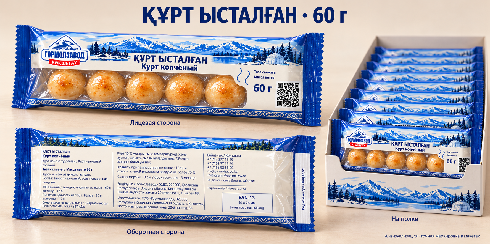
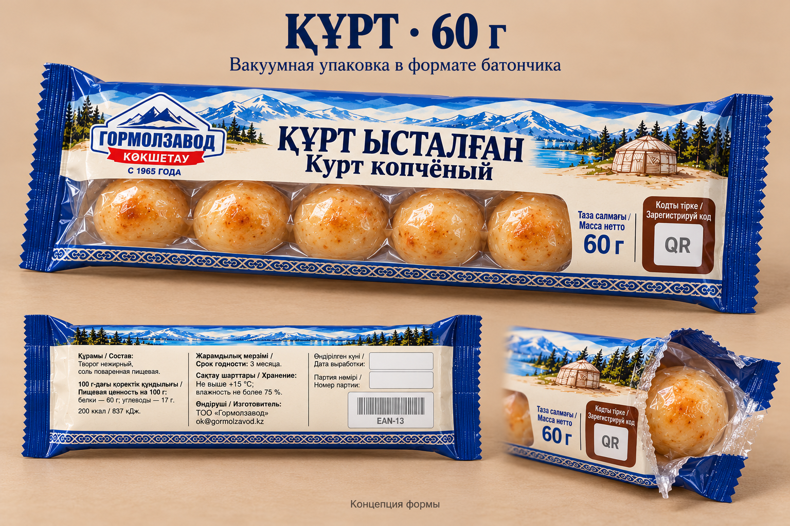
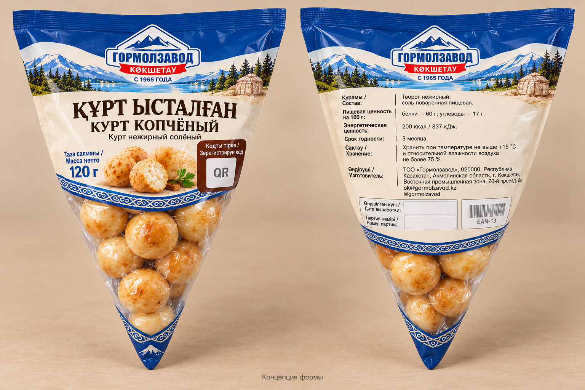
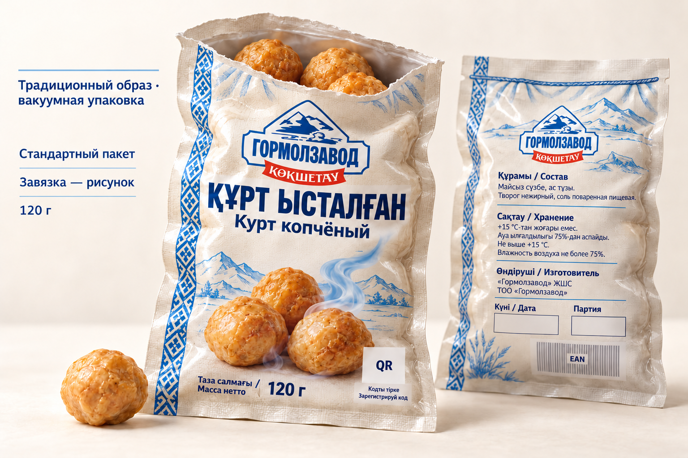
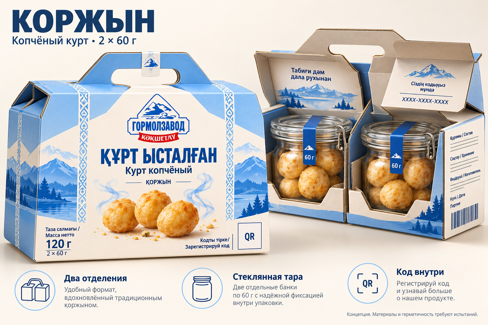

# Варианты упаковки копчёного курта

Все сохранённые варианты проекта на 20 октября 2026 года. **Окончательно выбран вариант 09: вакуумная упаковка в формате батончика, 60 г.** Остальные варианты сохранены как история разработки.

[Детализация выбранного варианта по ТЗ](../technical/final_bar_60g/README.md) · [Общий PDF, 14 страниц](../technical/final_bar_60g/Финальный_вариант_60г_Комплект.pdf). Концепция утверждена пользователем; производственный допуск ещё не получен.

| № | Вариант | Изображение / материалы |
|---|---|---|
| 01 | Картонная упаковка, 96 г | [Открыть](01_carton_96g.png) |
| 02 | Выдвижной пенал, 120 г | [Открыть](02_drawer_120g.png) |
| 03 | Стеклянная банка, 192 г | [Открыть](03_glass_192g.png) |
| 04 | Металлическая тара, 120 г | [Открыть](04_metal_120g.png) |
| 05 | Керамическая тара, 192 г | [Открыть](05_ceramic_192g.png) |
| 06 | «Қоржын», 2 × 60 г | [Открыть](06_qorzhyn_120g/01_qorzhyn_concept.png) · [Промпт](06_qorzhyn_120g/prompt.txt) |
| 07 | Вакуумный пакет под тканевый мешочек, 120 г | [Закрытый](07_vacuum_120g/01_dorba_vacuum_120g.png) · [Приоткрытый, без слова «Дорба»](07_vacuum_120g/02_open_pack_120g.png) · [Технический вариант в объёме и на полке](07_vacuum_120g/04_studio_shelf.png) |
| 08 | Кулёк с прозрачной частью, 120 г | [Открыть](08_kulek_120g/01_kulek_concept.png) · [Промпт](08_kulek_120g/prompt.txt) |
| 09 | Вакуумный пакет в формате батончика, 60 г | [Открыть](09_bar_vacuum_60g/01_bar_vacuum_60g.png) · [Промпт](09_bar_vacuum_60g/prompt.txt) |

## Выбранный окончательный вариант: формат батончика, 60 г

### Исходная выбранная концепция

## Кулёк

## Вакуумный пакет после вскрытия

## Қоржын

## Исходники и технические материалы

- [Первоначальные промпты пяти вариантов](initial_prompts.json).
- [Технический комплект картонной упаковки 120 г](../technical/carton_120g/README.txt).
- [Технический комплект прямоугольного вакуумного пакета 120 г](../technical/vacuum_120g/README.txt).
- [Общий PDF вакуумного комплекта](../technical/vacuum_120g/Комплект_для_просмотра.pdf).
- [Редактируемые SVG, данные ТЗ и скрипт сборки](../technical/vacuum_120g/source/).

Сгенерированные надписи и изображения штрихкодов не являются печатным оригиналом. Источник точных данных продукта — предоставленное ТЗ. QR, EAN новой фасовки, правила акции, материал и производственные параметры требуют завершения.

Для выбранного формата батончика подготовлены собственные макеты, предварительный чертёж 240 × 100 мм и схема сварки в `technical/final_bar_60g/`. Размеры и материал уточняются по пробному наполнению. Чертёж старого пакета 120 г к нему не применяется. Ранние варианты сохранены для истории.
